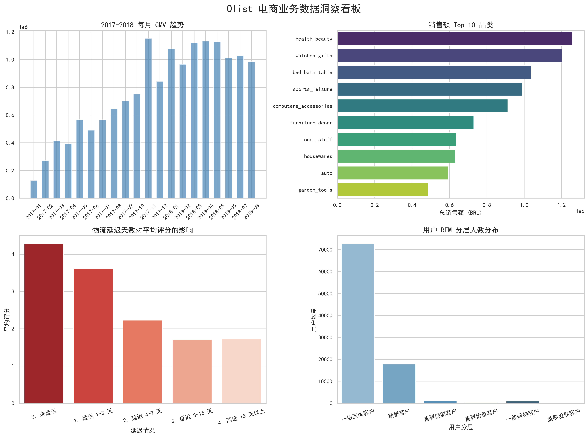

# Olist 巴西电商数据分析项目

## 📌 项目背景
本项目基于 Kaggle 开源的 Olist 巴西电商数据集（包含约 10 万条订单记录、9 张业务表），旨在通过数据清洗、SQL 分析与 RFM 建模，评估平台的销售趋势、用户留存与物流体验，并输出可落地的业务优化建议。

## 🛠️ 技术栈
- **数据处理**：Python (Pandas, NumPy)
- **查询引擎**：SQL (DuckDB)
- **数据可视化**：Matplotlib, Seaborn
- **工程化**：Git, Jupyter Notebook

## 🔍 核心分析发现

### 1. 销售趋势与品类表现
- **爆发式增长与黑五效应**：平台在 2017 年经历了订单量的爆发式增长，其中 2017 年 11 月（黑五大促）GMV 突破 110 万 BRL，订单量超 7000 单，客单价稳定在 150-170 BRL 左右。
- **品类差异**：`health_beauty`（美妆健康）贡献了最高的销售额占比（约 9.26%），而 `bed_bath_table`（床品家居）虽然订单量极大，但客单价较低。

### 2. 用户留存与价值分层 (RFM)
- **极低的复购率**：平台整体复购率仅为 **3.0%**（93,358 名真实用户中仅有 2,801 人复购），呈现典型的“一次性购买”耐用品电商特征。
- **核心用户流失预警**：基于业务规则修正后的 RFM 模型显示，高达 **77.96%** 的用户属于“一般流失客户”。
- **高价值用户稀缺**：真正属于“重要价值客户”的人数仅占 **0.40%**，贡献了 **1.07%** 的销售额。建议平台将运营重心从单纯的拉新，转向存量用户的精细化促活与召回。

### 3. 物流延迟对评分的影响 (体验归因)
- **延迟导致口碑断崖式下跌**：未延迟订单的平均评分为 **4.29 分**；只要延迟 1-3 天，评分立刻跌至 **3.61 分**；当延迟达到 4-7 天时，评分雪崩至 **2.23 分**（跌破及格线）；延迟超过 8 天，评分彻底降至 **1.7 分**左右。
- **业务建议**：用户的耐心极限是 3 天。建议平台建立物流预警机制，一旦预测到延迟超 3 天，应主动触发客服介入与优惠券安抚，而非等待差评产生。

## 📈 数据看板
以下是基于 Python 生成的核心业务洞察看板：

*(看板展示了：销售 GMV 趋势、Top 10 品类、物流延迟评分归因、以及 RFM 用户分层)*

## 🚀 如何复现
1. Clone 本仓库。
2. 在 Kaggle 下载 Olist 数据集并放入 `data/raw/` 目录。
3. 依次运行 `notebooks/` 目录下的文件（01 业务理解 -> 02 数据清洗 -> 03 SQL与分析）。# Olist E-Commerce Data Analysis
